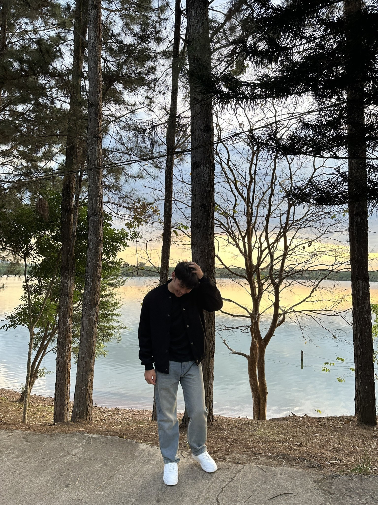

  

  

## 👨🏻‍💻 About Me

- 🙋‍♂️ I’m **Truong Van Khai (onlyKai)**, a student at **FPT University**.

- 📍 Based in **Ho Chi Minh City, Vietnam**.

- 🔭 My focus is `Java Web Development` and `Game Development`.

- 🌱 Learning, building, and improving one project at a time.

- 🤝 Interested in collaborating on `Web Apps` and `Games`.

- 💬 Ask me about anything, If I know😅

- ⚡ Fun fact: I waste most of my time playing games.

### 🎮 Beyond the Code

- 🦾 An Iron Man fan — always inspired to build something cool.

- 🎮 Playing games today, creating my own tomorrow.

- 🌿 Finding fresh ideas away from the screen.

---

  
  
  
  
  

<h2>🛠️ Tech Stack</h2>

<table align="center">
  <tr>
    <td><b>Languages</b></td>
    <td>
      
      
      
    </td>
  </tr>
  <tr>
    <td><b>Backend &amp; APIs</b></td>
    <td>
      
      
      
      
    </td>
  </tr>
  <tr>
    <td><b>Frontend</b></td>
    <td>
      
      
      
    </td>
  </tr>
  <tr>
    <td><b>Databases</b></td>
    <td>
      
      
      
    </td>
  </tr>
  <tr>
    <td><b>DevOps, Cloud &amp; Tools</b></td>
    <td>
      
      
      
      
      
      
    </td>
  </tr>
</table>
